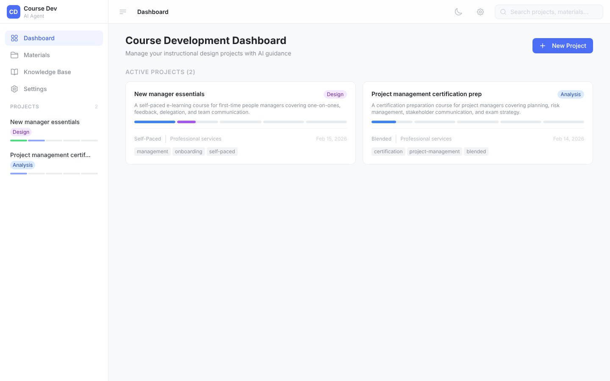
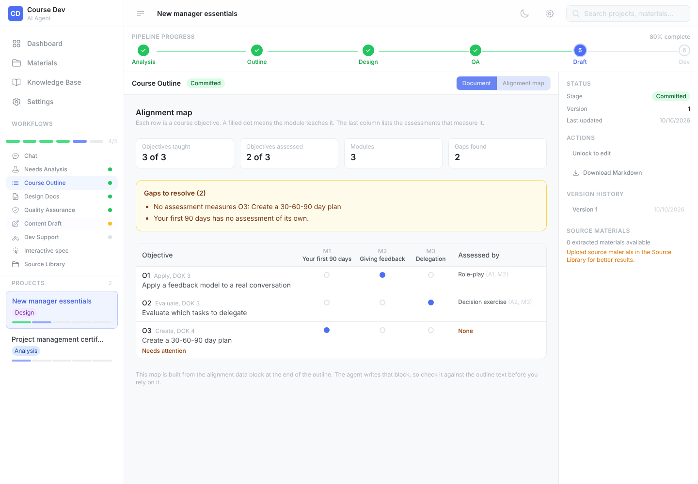

# Course Development Agent

**A side-kick for instructional designers: bring your source material, leave with a build-ready course package.**

You bring the SME notes, old decks, and product docs. The agent interviews you, then works through a five-stage design pipeline with you in the driver's seat. You review, edit, and commit every stage before the next one begins. It works for learning of any shape, size, or audience, from a 10-minute micro-lesson to a certification program.



> This is a **developer handoff pipeline**, not a content generator. Each artifact is a structured scaffold that a course developer takes into Rise 360, PowerPoint, Storyline, or Captivate to build the real thing. The AI does the heavy instructional design reasoning. You make the decisions.

---

## What you get

| Stage | What the agent produces |
|---|---|
| **Needs analysis** | Learner personas, performance gap analysis, Kirkpatrick targets, enduring understandings, constraints, recommended approach |
| **Course outline** | A module structure aligned to Bloom's verbs, Webb's DOK levels, Fink's Significant Learning dimensions, and Merrill's five beats, plus assessment strategy and sequencing rationale |
| **Design document** | Module design briefs in storyboard format, learner experience narrative, instructional rationale, WCAG 2.2 AA accessibility specs, technical specifications |
| **Quality assurance** | An evaluative report with verb-drift analysis, DOK rigor audit, scaffold fading check, source fidelity review, and a go or no-go call |
| **Content draft** (optional) | Paste-ready draft copy for one module at a time: Rise 360 blocks, or ILT slides with speaker notes. Every fact traces to your source materials, and anything inferred is tagged for review |
| **Dev support** | A developer handoff package with per-module build briefs, SAM Alpha, Beta, and Gold priority flags, custom interaction candidates, an SME review protocol, and a developer QA checklist |

Two extras sit alongside the pipeline:

- **Alignment map.** On the Course Outline, switch to the Alignment map tab to see which modules teach and which assessments measure each objective, with the gaps called out.
- **Interactive spec.** Describe one moment a stock Rise 360 block can't handle, and get a 16-section build spec for a custom interactive component. It writes the spec only, never the code.



---

## Quickstart

You need [Node.js](https://nodejs.org) 18.17 or later and an API key from [Anthropic](https://console.anthropic.com) or [Google AI Studio](https://aistudio.google.com).

```bash
git clone https://github.com/boochcodespace/course-development-agent.git
cd course-development-agent
npm install
npm run dev
```

Open http://localhost:3000, then:

1. Go to **Settings** and open the **API Keys** tab.
2. Paste your key, choose your provider, and select **Test connection**.
3. Go back to the dashboard and create a project.

You don't need a `.env` file. Keys are saved to `.claude-secrets.json` in the project folder, which git ignores.

---

## How it works

### 1. The intake interview

Open a new project, upload your source materials, and go to **Chat**. The agent doesn't start building. It plans first:

1. **Takes inventory** of what your materials actually say, and flags gaps and contradictions.
2. **Proposes a full spec** for the course, including audience, format, module arc, and risks.
3. **Interviews you** with 3 to 8 targeted questions. Each comes with a recommended answer, so you confirm or redirect instead of starting from a blank page.
4. **Presents a brief** and waits. The Needs Analysis only starts after you approve it.

The questions it can't answer from your materials become a ready-made list to take back to your subject matter expert.

### 2. The pipeline

Every stage follows the same pattern:

1. Select **Generate**. The agent reads your materials and every committed earlier stage.
2. Read the draft in the Markdown canvas and edit it directly.
3. Use **Regenerate with guidance** for targeted changes.
4. Select **Commit** when you're happy. The next stage unlocks.

Every commit is a new version. Older versions stay readable. If you unlock a committed stage to revise it, the stages after it are marked stale until you commit again.

### 3. Drafting content, module by module

After QA, the optional **Content Draft** stage writes the actual words. Pick a module and a format (Rise 360 blocks or ILT slides with speaker notes), and the agent drafts that one module. One module per run gives better writing than a whole course at once. Draft more modules, redraft any of them, and commit when you're happy. Dev Support then points developers to the committed draft.

### 4. Revising mid-pipeline

The project chat knows your whole pipeline. Ask it things like:

- "Add a module on exception handling between modules 2 and 3."
- "The needs analysis missed that our audience includes new hires. Update it."
- "The outline looks good. Let's do the design document."

It restates the change, waits for your OK, applies a targeted edit, and shows you a diff.

---

## Bring your own style guide

The agents write to a style guide, and you choose which one. A plain-language guide ships in the box. To use your own:

1. Create `style-guides/custom/my-guide/style-guide.md`.
2. Optionally add a `content-type-rules.md` for format-specific rules.
3. Open **Settings**, find **Style guide**, and pick your guide.

Anything in `style-guides/custom/` stays on your machine and is ignored by git. See [`style-guides/README.md`](style-guides/README.md) for tips on writing a guide the model follows well.

The active guide is added to every prompt, so every stage writes to it, and the QA stage checks the design document against it.

---

## The research behind it

The agents and knowledge files draw on established learning science. The full text of each framework lives in [`.claude/knowledge/`](.claude/knowledge).

| Principle | Source | Where applied |
|---|---|---|
| Bloom's Revised Taxonomy | Anderson and Krathwohl (2001) | Objective writing, verb-drift QA |
| Webb's Depth of Knowledge | Webb (1997, 2002) | Assessment rigor auditing |
| Fink's Significant Learning | Fink (2003) | Course-level objective design |
| SOLO Taxonomy | Biggs and Collis (1982) | Formative assessment rubrics |
| Marzano's New Taxonomy | Marzano and Kendall (2007) | Motivation-aware design |
| Merrill's First Principles | Merrill (2002) | Lesson scaffold structure |
| Gagné's Nine Events | Gagné (1985) | Lesson beat design |
| Kirkpatrick Model | Kirkpatrick (1959, 2016) | Needs analysis, QA review |
| Understanding by Design | Wiggins and McTighe (1998) | Enduring understandings, essential questions |
| Scaffolding and the ZPD | Vygotsky (1978), Wood, Bruner and Ross (1976) | Scaffold fading, module sequencing |
| Cognitive Load Theory | Sweller (1988), Mayer (2021) | Content and media design |
| WCAG 2.2 AA | W3C (2023) | Accessibility audit |
| UDL 3.0 | CAST (2024) | Accessibility and inclusion design |
| Self-Determination Theory | Deci and Ryan (1985) | Motivation framing |
| ARCS Model | Keller (1987) | Facilitator guide structure |
| SAM | Allen and Sites (2012) | Development iteration rhythm |

---

## Known limits

This is an early release, built for one person on one machine. Please read this before you rely on it.

- **No database.** Projects, artifacts, and chat history live in your browser's local storage. Clearing site data deletes them. Export what matters (copy the Markdown out of the canvas).
- **No sign-in or multi-user support.** Don't expose the dev server to the internet.
- **Your content goes to the AI provider you choose.** Don't upload material you aren't allowed to share with them.
- **Output needs your review.** The agents ground claims in your source materials and flag inferences, but they can still be wrong. You commit every stage for a reason.
- **QA is an AI review, not an audit.** It's a useful second pair of eyes. It doesn't replace a full accessibility audit, an SME review, or testing the finished course.
- **The app doesn't produce SCORM files.** It produces plans, draft content, and build specs. You build and publish in Rise 360 or your authoring tool.
- **Vendor facts age.** The Rise 360 and LMS guidance in `.claude/knowledge/rise-spec/` was compiled from vendor documentation and community testing in 2025 and 2026. Check current documentation and test in your own LMS.
- **The alignment map is only as good as the data behind it.** The agent writes that data, so check the map against the outline text.
- **No export formats yet** beyond copying and downloading Markdown (see the roadmap).

---

## Extending it

You don't need to write code to change how the agents behave.

| To change | Edit |
|---|---|
| What a stage produces | The spec in [`.claude/agents/`](.claude/agents) |
| Support for another LMS | A profile in [`.claude/knowledge/rise-spec/`](.claude/knowledge/rise-spec) (see the [knowledge README](.claude/knowledge/README.md)) |
| The frameworks agents reason with | The files in [`.claude/knowledge/`](.claude/knowledge) |
| How everything is written | A guide in [`style-guides/`](style-guides) |
| The standing instructions for agents | [`CLAUDE.md`](CLAUDE.md) |

### Tech stack

- Next.js 14 (App Router), TypeScript, Tailwind CSS
- Zustand with local storage persistence
- Anthropic Claude and Google Gemini behind one provider interface
- File extraction with `pdf-parse`, `mammoth` (DOCX), `xlsx`, and `officeparser` (PPTX)

### Architecture notes

**Agents.** Each stage has a spec in `.claude/agents/`. The generate route loads the spec, adds the matching knowledge files, your source materials, the committed earlier artifacts, and the active style guide, then calls the provider. `src/lib/ai/agents.ts` holds TypeScript fallbacks for environments without file access.

**Providers.** `src/lib/ai/provider.ts` defines one interface with an Anthropic and a Google implementation. To add another, drop a file in `src/lib/ai/providers/` and add a case to the factory.

**Secrets.** `src/lib/secrets/` defines a `SecretsProvider` interface with a local-file implementation (`0600` permissions). Cloud secret managers can slot in the same way.

**Style guides.** `src/lib/style-guide/loader.ts` discovers guides in `style-guides/` and `style-guides/custom/`. The active guide is injected into every prompt by `composeSystemPrompt`.

### Project structure

```
.claude/
  agents/            Stage specs (one per pipeline stage)
  commands/          Slash commands for Claude Code (interviewer, style enforcer)
  knowledge/         Framework reference files the agents read (see its README)
style-guides/
  default/           The plain-language guide that ships with the app
  custom/            Your own guides (ignored by git)
src/
  app/api/           chat, stages/generate, materials, settings, style-guides
  components/        UI by feature (stages, chat, materials, tools, settings, ...)
  lib/
    ai/              Providers, agent definitions, prompt composition
    agents/          Spec and knowledge loader
    style-guide/     Style guide discovery and loading
    alignment.ts     Reads and checks the outline's alignment data
    content-draft.ts Module parsing and per-module draft merging
    rise-spec.ts     Interactive spec validation and LMS profiles
    secrets/         Secrets provider abstraction
    store.ts         Zustand store
    types.ts         Shared types
tests/               Unit tests (npm test)
scripts/             Publishing helpers
CLAUDE.md            Standing instructions and knowledge base for agents
```

### Scripts

```bash
npm run dev         # start the dev server
npm run build       # production build
npm run typecheck   # TypeScript check
npm run lint        # ESLint
npm test            # unit tests
```

---

## Roadmap

See [`ROADMAP.md`](ROADMAP.md) for what's planned and where help is most welcome.

## Contributing

Designers and developers are both welcome. Read [`CONTRIBUTING.md`](CONTRIBUTING.md) to get started. Please follow the [code of conduct](CODE_OF_CONDUCT.md). To report a security issue, see [`SECURITY.md`](SECURITY.md).

## License

[MIT](LICENSE). Copyright (c) 2026 Christopher Buccella.
